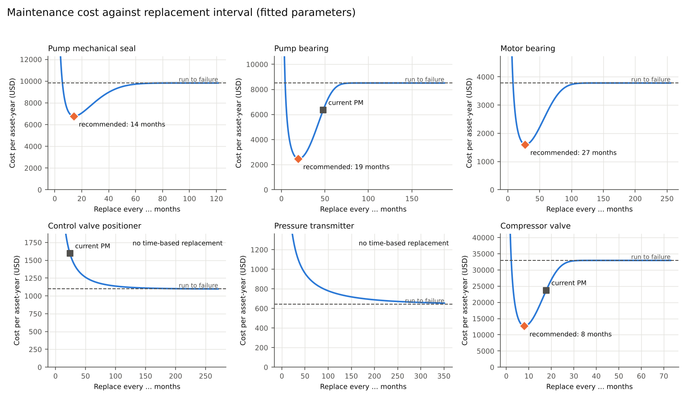
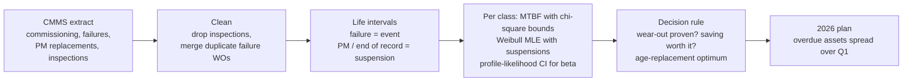
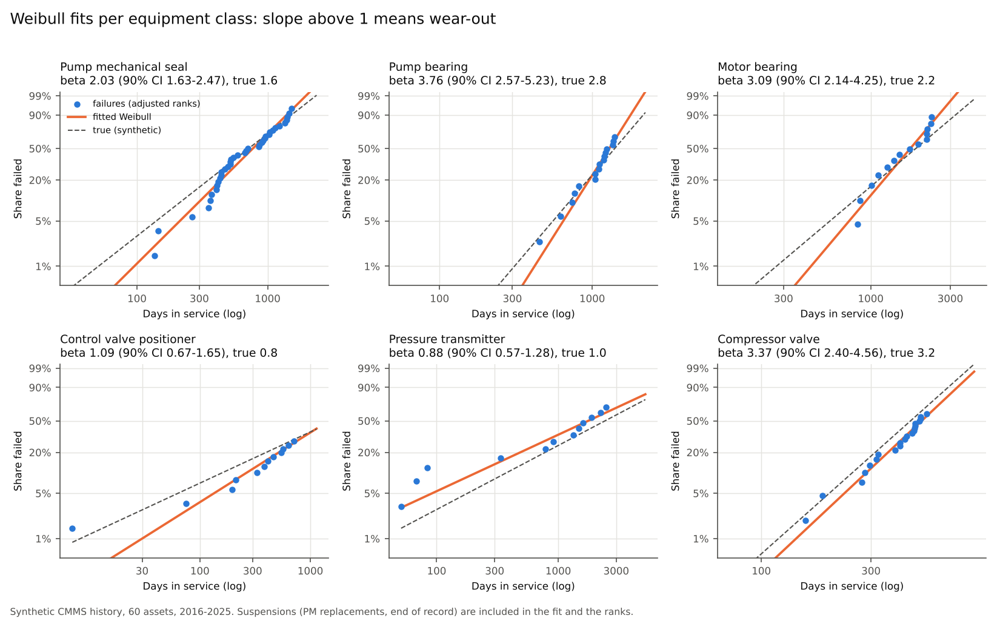
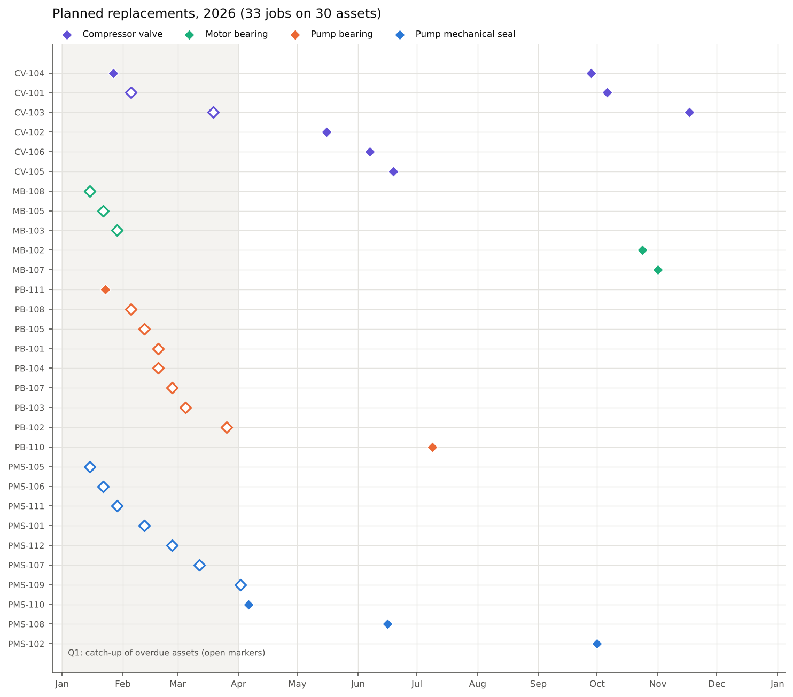

# MTBF-based maintenance scheduler

**Take the failure and replacement history from a CMMS, work out per equipment class whether failures come from wear-out or at random, and turn that into a replacement interval and a dated 2026 plan, but only where replacing early actually pays.**




## Problem statement

Most PM intervals were set once, from a vendor manual or habit, and never checked against the plant's own history. That costs money both ways. Replacing too late means breakdowns, with their lost production, emergency repair rates and process upsets. Replacing parts that don't wear out is worse than useless: a new part with early-life failures gets *more* failures, not fewer.

A single MTBF number can't tell these cases apart. The shape of the failure distribution can. This tool fits it per class, applies the classic age-replacement cost model, and gives the planner a dated schedule.

## Features

- Cleans a CMMS extract: drops inspection-only entries and merges duplicate failure work orders
- Builds life intervals and treats PM replacements and still-running items as **suspensions**, not failures
- Per class: crude MTBF with chi-square bounds, Weibull β and η by maximum likelihood, and a profile-likelihood interval for β
- Cautious decision rule: time-based replacement only where wear-out is proven and the saving is worth it
- Age-replacement cost model gives the interval and the cost per asset-year of every option
- Dated 2026 replacement plan, with overdue assets spread over Q1
- FastAPI `/fit` endpoint that runs the same decision for any one class's history

## Tech stack

| Tool | Used for | Why this one |
|---|---|---|
| Python, pandas | CMMS cleaning, life intervals, schedule | Standard and readable |
| NumPy, SciPy | Weibull likelihood, chi-square bounds, cost-rate optimisation, incomplete gamma for ∫R(t)dt | Written out in full so every step can be checked; SciPy's own censored fit is used as an independent cross-check |
| Matplotlib | Weibull probability plots, cost curves, plan chart | |
| FastAPI | `/fit` endpoint | The course's deployment step: lightweight, with interactive docs |
| pytest, GitHub Actions | Maths and API tests on every push | Each formula is tested against a textbook value or an independent calculation |

## Approach



| Stage | Where | Technique | Why this one |
|---|---|---|---|
| Cleaning | `src/data/` | Drop inspection-only entries; merge failure work orders on the same asset within 3 days | Real CMMS extracts double-book failures and mix in entries that renew nothing. Counting them would distort every rate. |
| Life intervals | `src/features/` | Each interval runs from one renewal to the next. Ending in a failure = event. Ending in a PM replacement or at the end of the record = **suspension** (right-censored) | Dropping suspensions, or counting them as failures, is the most common error in field MTBF work. It makes equipment look worse than it is. |
| MTBF | `src/models/` | Total operating time / failures, with two-sided chi-square bounds | The familiar figure, but it assumes a constant failure rate. It is shown for comparison only. |
| Weibull fit | `src/models/` | Maximum likelihood with suspensions (profile likelihood in β, with η in closed form), cross-checked against SciPy's independent censored-data fit | β is the decision variable: below 1 means early-life failures, about 1 random, above 1 wear-out. |
| Confidence in β | `src/models/` | Profile-likelihood interval | With 12–20 failures per class, the bootstrap interval I tried first was too narrow (see validation). |
| Replacement interval | `src/maintenance/` | Age-replacement cost model: cost rate C(T) = [Cp·R(T) + Cf·(1 − R(T))] / ∫₀ᵀ R(t)dt, minimised over T, then rounded *down* to whole months | It weighs planned cost against failure cost (repair plus lost production) and gives a cost per asset-year for every interval. |
| Decision rule | `src/maintenance/` | Time-based replacement only if the **lower** 90% bound of β is above 1.1 **and** the saving against run-to-failure is at least 10%. Otherwise, run to failure or use condition monitoring | Cautious with small samples: wear-out has to be shown by the data, not just suggested by the point estimate. |
| 2026 plan | `src/pipeline.py` | Due date = last renewal + interval; assets already overdue on 1 January spread one a week over Q1, oldest first | A stricter policy should not dump 19 jobs into the first week |
| Deployment | `src/api/` | FastAPI `/fit`: send one class's life intervals and costs, get β with its interval and the recommendation | Re-run the decision for a new class without the full pipeline |

## Project structure

```
mtbf-maintenance-scheduler/
├── data/
│   ├── raw/             synthetic CMMS events and equipment classes; ground_truth/ for validation only
│   ├── processed/       life intervals
│   └── sample/          the events of 10 assets for a quick look
├── models/              fitted Weibull per class (weibull_fits.json) + model card
├── notebooks/           01_walkthrough.ipynb: every stage with outputs
├── reports/             class_summary.csv, pm_schedule_2026.csv, validation.json, figures/
├── src/
│   ├── api/             FastAPI service
│   ├── data/            generate_synthetic, load_data, preprocess
│   ├── features/        life_intervals
│   ├── models/          reliability (MTBF, Weibull MLE, CI), train, evaluate (robustness)
│   ├── maintenance/     policy (age-replacement cost model, decision rule)
│   ├── utils/           paths, plots
│   └── pipeline.py      stages wired together, 2026 schedule, validation
├── tests/               maths and API tests
├── .github/workflows/   CI: tests + full pipeline on every push
├── requirements.txt
├── README.md
└── main.py              runs every stage
```

## How it was validated

The history is synthetic, generated from known Weibull parameters for each class, so every estimate and every decision can be checked against the truth.

1. **The maths.** Unit tests check the chi-square bounds against a textbook case, the closed-form ∫R(t)dt against numerical integration, the optimum against a brute-force grid, and the adjusted ranks against Benard's formula. The MLE agrees with SciPy's censored Weibull fit to within 0.00005%.
2. **Parameter recovery.** On a plant 20 times larger, every class's β comes back within 0.1 of the truth. This proved the generator and the fitting code correct before small-sample behaviour was judged.
3. **Interval coverage over 200 synthetic plants.** The 90% profile-likelihood interval for β covered the truth 88.6% of the time. The percentile bootstrap I started with covered only 78%, so it was replaced.
4. **Decisions judged with the true parameters,** on the sample plant and on 100 synthetic plants: is the replace / don't-replace call right, and what share of the achievable saving does the recommended interval capture?
5. **Engineering sense-check of the figures.** Probability plots should be straight lines, and cost curves should have a clear minimum only for wear-out classes.

## Results

60 assets in 6 classes, commissioned 2016–2019, history to the end of 2025: 113 failures and 105 suspensions after cleaning (114 inspection entries and 6 duplicate failure work orders removed).

| Class | Failures | Crude MTBF (days) | Weibull β, 90% CI (true β) | Current PM | Recommendation |
|---|---|---|---|---|---|
| Pump mechanical seal | 38 | 910 | 2.03, 1.63–2.47 (1.6) | none | replace every **14 months** |
| Pump bearing | 16 | 2,127 | 3.76, 2.57–5.23 (2.8) | 48 months | replace every **19 months** |
| Motor bearing | 14 | 2,103 | 3.09, 2.14–4.25 (2.2) | none | replace every **27 months** |
| Control valve positioner | 12 | 2,286 | 1.09, 0.67–1.65 (0.8) | 24 months | **stop** time-based replacement |
| Pressure transmitter | 12 | 2,569 | 0.88, 0.57–1.28 (1.0) | none | no time-based replacement |
| Compressor valve | 21 | 787 | 3.37, 2.40–4.56 (3.2) | 18 months | replace every **8 months** |

**Judged with the true parameters** (cost per year for the whole fleet):

| Policy | Cost per year |
|---|---|
| Run everything to failure | $478,400 |
| Current practice | $416,758 |
| **Recommended plan** | **$256,210 (−38%)** |
| True optimum (unknowable in practice) | $254,250 |

All six replace / don't-replace decisions match the truth. The recommended intervals capture 96–100% of the achievable saving in each class. The plan also stops the 2-yearly positioner replacement. Positioners have early-life failures (true β 0.8), so replacing them added cost: $1,745 against $744 per asset-year when run to failure.

**Across 100 synthetic plants:**

| Class | 90% CI covers true β | Decision matches truth | Median share of saving captured |
|---|---|---|---|
| Pump mechanical seal | 91% | 88% | 99% |
| Pump bearing | 88% | 99% | 99% |
| Motor bearing | 86% | 82% | 98% |
| Control valve positioner | 91% | 100% | 100% |
| Pressure transmitter | 84% | 93% | n/a |
| Compressor valve | 86% | 100% | 100% |

Fleet cost under the recommended plan is a median **38% below current practice** and **1.3% above the true optimum** (95th percentile 9.1%).

**Where it goes wrong, and why that is acceptable.** Most wrong decisions are cautious ones. With only 10–14 failures, the lower bound of β sometimes falls under 1.1 for a wear-out class (seal, motor bearing), so no time-based plan is set and that class runs to failure until more history builds up. Less often (transmitter, 7%), a random-failure class looks like wear-out by chance, and a replacement interval is set that adds a little cost.

**Two cautions the numbers carry:**
- *Crude MTBF misleads when PM is in place.* For compressor valves, crude MTBF is 787 days, while the Weibull mean life is 499 days. Current replacements at 18 months cut lives short before failure, so the crude figure flatters the equipment.
- *β estimates from ~15 failures are wide.* On this sample, the seal's interval (1.63–2.47) narrowly misses its true β of 1.6, which is the 1-in-10 event a 90% interval allows. The recommended interval still captured 96% of the possible saving.





The 2026 plan has 33 replacement jobs on 30 assets. Nineteen assets are already past the new interval on 1 January, because past practice was more relaxed, so they are spread one a week across Q1, oldest first, rather than all landing in one week. The full list is in `reports/pm_schedule_2026.csv`.

### Assumptions and limits

- Repair or replacement restores the part to as-good-as-new. That fits replaceable components (seals, bearings, positioners), but not whole machines that are patched rather than renewed.
- Costs are illustrative inputs in `data/raw/equipment_classes.csv`. The failure cost should include lost production, which is what usually makes planned replacement pay.
- Downtime for repair is ignored in the time base, because it is small against lives of months to years.
- Classes with fewer than 3 failures are reported as "insufficient failure data" rather than fitted.
- Condition monitoring, where it exists, should override a time-based plan. This tool decides where a fixed interval makes sense at all.

## What makes it different

- **It uses suspensions properly.** PM replacements and still-running items count as survival time, not failures, which is where most field MTBF figures go wrong.
- **It can say "don't replace".** The decision rests on the shape of the failure distribution, so it stops time-based replacement where it adds failures (the positioners) as well as setting intervals where it pays.
- **It is judged against the truth.** Every decision and every cost figure is checked against the true parameters, on one plant and on 100.

## How to run

```bash
python -m venv .venv && source .venv/bin/activate
pip install -r requirements.txt
python main.py                          # all stages: analysis, 2026 plan, validation, figures, fitted model
pytest                                  # maths and API tests
uvicorn src.api.app:app --reload        # API; open http://127.0.0.1:8000/docs
```

`python main.py --regenerate --seed 7` builds a different synthetic plant, and `python main.py --robustness 100` judges the method on 100 synthetic plants (about 10 s). The notebook `notebooks/01_walkthrough.ipynb` shows every stage with its outputs.

## What I learned

- **Check the interval, not just the estimate.** The bootstrap interval for β looked reasonable but covered the truth only 78% of the time; only the 200-plant check showed it, and the profile-likelihood interval fixed it.
- **Crude MTBF hides the decision.** Two classes with almost the same MTBF needed opposite strategies, because one wears out and the other fails at random.
- **A cautious rule costs little.** When the rule is wrong, it is usually by waiting for more failures, and the fleet cost still ends up close to the true optimum.

## Data note

**All data in this repository is synthetic**, generated by `src/data/generate_synthetic.py` from stated Weibull parameters. Asset IDs, dates, costs and every event are invented. No employer data, CMMS extracts, failure records or plant names were used.

This is a public re-implementation of a personal prototype built on sample data. It has not been deployed at any plant. With real data, the class grouping, the costs and the as-good-as-new assumption would all need engineering review first.

## Credits

Built with Claude Code; design, requirements and validation by Raja (Rajayoganandha Sekaran).

Licence: MIT.
